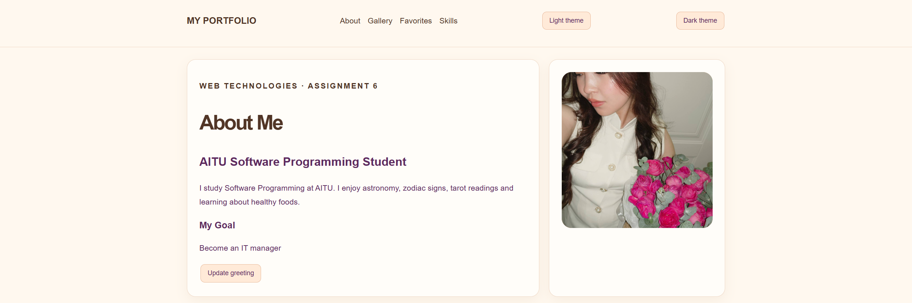
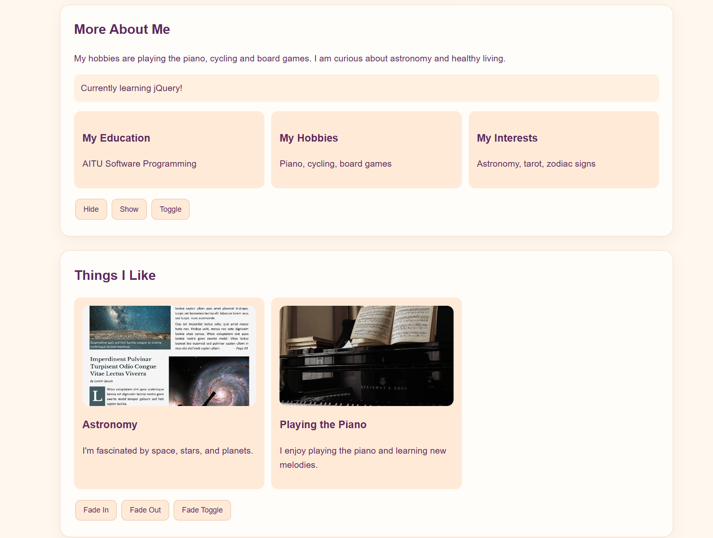
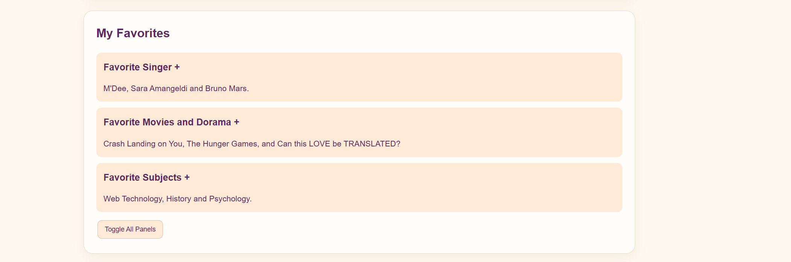
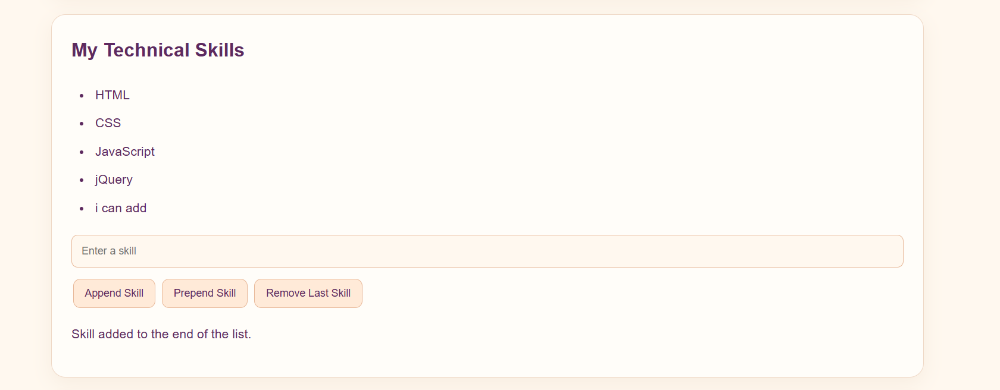
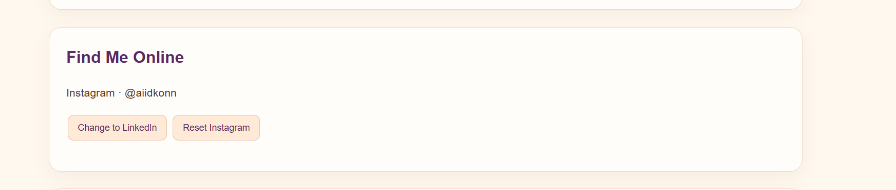
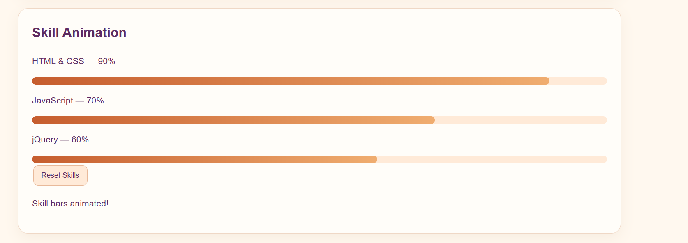

# Assignment 6 – My Personal Portfolio

Name: AIDANA MURATOVA SE-2539

GitHub Repository:https://github.com/muratovaajdana201-ctrl/assignment6webaidana

GitHub Pages: https://muratovaajdana201-ctrl.github.io/assignment6webaidana/

## About the Project

For this assignment, I created a personal portfolio website using HTML, CSS and jQuery. The website contains information about me, my hobbies, interests, favorite things and technical skills.

My main goal was to practise the jQuery methods from the assignment and understand how they can make a website interactive. I worked on the project step by step and added different buttons, effects, animations and a live form preview. I also tried to make the design personal and comfortable to use.

## Technologies Used

-HTML5 – for the structure of the website.
-CSS3 – for styling, layout and responsive design.
-JavaScript – for the website logic.
-jQuery 3.7.1 – for selectors, events, effects and DOM manipulation.

## Part 1: jQuery Basics and Selectors

### Task 0. Document Ready

First, I connected the jQuery library to my HTML file using the official CDN. Then I used $(document).ready() to make sure that the HTML document was loaded before running the jQuery code.

I also added console.log() to check that jQuery was connected correctly. When the page loads, the message "jQuery is ready!" appears in the browser console.

### Task 1. Selectors and CSS Changes

In this task, I practised three types of jQuery selectors:

-Tag selector: $("h1")
-ID selector: $("#greeting")
-Class selector: $(".intro")

I used .css() to change the styles of selected elements and .text() to update the greeting on the page. I also added light and dark theme buttons. They change the website theme by adding and removing CSS classes from the body element.

This task helped me understand how jQuery can select HTML elements and change their appearance and content.

## Part 2: jQuery Effects

### Task 2. Hide, Show and Toggle

I added an About Me section with my personal information, current status and fun facts. I created three buttons: Hide, Show and Toggle.

Each button uses a different jQuery method:

-.hide() hides the information.
-.show() makes it visible again.
-.toggle() changes its visibility.

I used these methods with a small animation duration to make the changes smoother.

### Task 3. Fade Effects

For this task, I added two images to my gallery. They represent my interests and hobbies.

I used three jQuery fade methods:

-.fadeIn() makes the images appear.
-.fadeOut() makes the images disappear.
-.fadeToggle() switches between these two states.

I connected each method to a separate button, so the user can control the gallery.

### Task 4. Slide Effects and Accordion

I created three clickable sections with my favorite music, movies and subjects. Each section has a heading and a content panel.

When I click a heading, the panel opens or closes with a slide animation. I used .slideDown() to open a panel, .slideUp() to close it and .slideToggle() for the button that controls all panels.

I also added a button to open or close all sections at once.

## Part 3: DOM Manipulation and Other jQuery Methods

### Task 5. Adding and Removing Skills

I created a list of my technical skills, including HTML, CSS, JavaScript and jQuery. I also added an input field and three buttons to manage the list.

-.append() adds a new skill to the end of the list.
-.prepend() adds a new skill at the beginning.
-.remove() deletes the last skill.

I added a check to prevent empty skills from being added. After adding a skill, the input field is cleared and a short message appears on the page.

### Task 6. Changing Attributes

For this task, I added a link to my Instagram profile and a button that changes its destination to LinkedIn.

I used the .attr() method to change the href attribute of the link. I also added a reset button to return the link to Instagram.

This helped me understand how jQuery can change HTML attributes without editing the HTML directly.

### Task 7. Live Form Preview

I created a simple contact form with two input fields: Name and Email.

I used .val() to get the values entered by the user and .text() to display them in the live preview section. The preview updates automatically while the user is typing, without refreshing the page.

This task helped me practise working with input fields and handling user input with jQuery.

### Task 8. Animations

In the final task, I created three skill bars for HTML and CSS, JavaScript and jQuery. At the beginning, all bars have zero width.

I used the .animate() method to change their widths to different values: 90%, 70% and 60%. I also added a button that resets all bars back to zero.

This was a good way to practise jQuery animations and see how they can be used to make a website more interactive.

## What I Learned

While working on this assignment, I got more practice with jQuery and learned how to use it together with HTML and CSS. I understood better how selectors work and how to select elements by their tag, ID or class.

I also practised different effects, such as hiding and showing elements, fading images and creating slide animations. Another important part was DOM manipulation: I learned how to add new elements to a list, remove them and change HTML attributes.

I also became more familiar with reading values from input fields and updating the page while the user is typing. The .animate() method helped me understand how to create simple animations with jQuery.

At first, I needed some time to understand which method was better for each task, but testing the buttons and checking the results in the browser helped me understand how everything works.

## Conclusion

Overall, I enjoyed working on this assignment because I could create something personal while practising the jQuery methods from our course. I completed the tasks one by one and tried to use each method in a real part of my portfolio instead of adding examples without a purpose.

I am happy with the final result because the website includes my personal information, hobbies, interests and skills, as well as different interactive features. I learned how to make a page more dynamic using jQuery and how to connect buttons, input fields and animations with HTML elements.

In the end, I uploaded my project to a public GitHub repository and published it using GitHub Pages. This assignment helped me understand jQuery better and gave me more confidence in creating interactive websites.
